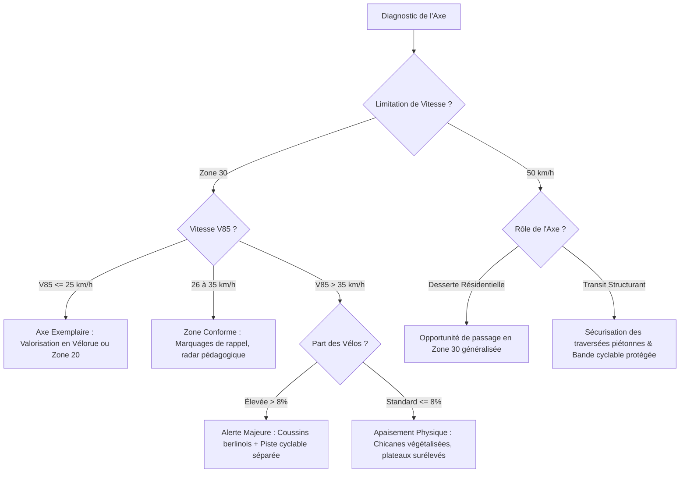

# Cadre Méthodologique & Précautions d'Interprétation des Données
## Observatoire Citoyen de la Mobilité — Commune de Rixensart (2024–2026)

---

## 1. Introduction & Contexte du Projet

L'**Observatoire Citoyen de la Mobilité de Rixensart** a pour mission de quantifier, objectiver et analyser les flux de circulation sur le territoire communal (Rixensart, Genval, Rosières). Face aux débats récurrents autour de la vitesse réelle, du respect des **Zones 30**, du transit de contournement et de la sécurité des cyclistes et piétons, cet observatoire s'appuie sur la collecte continue et ouverte de données physiques issues de **capteurs citoyens connectés Telraam S2**.

Entre novembre 2024 et fin 2026, le réseau a comptabilisé plus de **27 millions de détections**, fournissant une base empirique pour guider les politiques publiques locales d'aménagement et de sécurité routière.

### 1.1 Composition du Réseau de Comptage

Le dispositif communal s'articule autour de deux ensembles de capteurs :

1. **Le Réseau Officiel Municipal (10 capteurs S2)** : déployés en concertation avec l'administration communale sur des axes stratégiques (liaisons intervillages, voiries structurantes, pôles scolaires, gares et cœurs de quartier).
2. **Les Vigies Citoyennes Complémentaires (3 capteurs S2)** : installés à l'initiative d'habitants ou de collectifs (ex. projet « *L'école compte* » à Rosières, dessertes résidentielles à Genval).

| ID Capteur | Rue & Axe Observé | Localité | Rôle Fonctionnel dans le Maillage | Limitation Légale | Statut Réseau |
| :--- | :--- | :--- | :--- | :---: | :---: |
| **9000007490** | Rue de Genval | Rixensart | Axe de liaison Rixensart – Genval | 50 km/h | Officiel Municipal |
| **9000007492** | Chaussée de La Hulpe | Rosières | Artère régionale / transit E411 & La Hulpe | 50 km/h | Officiel Municipal (actif jusqu'en 12/2025) |
| **9000007497** | Avenue Franklin Roosevelt | Rixensart / Genval | Artère majeure de transit intercommunal | 50 km/h | Officiel Municipal |
| **9000007509** | Rue de l'Institut | Rixensart | Desserte résidentielle et scolaire | 50 km/h | Officiel Municipal |
| **9000007512** | Rue de la Tasnière | Genval | Quartier résidentiel et accès collines | **30 km/h** | Officiel Municipal |
| **9000007523** | Rue Haute | Rixensart | Axe secondaire d'accès au centre communal | 50 km/h | Officiel Municipal |
| **9000007530** | Place Communale | Genval | Cœur de quartier, commerces et convivialité | **30 km/h** (Zone 20) | Officiel Municipal |
| **9000007533** | Avenue Albert 1er | Rixensart / Genval | Axe structurant majeur et accès gare de Genval | 50 km/h | Officiel Municipal |
| **9000007534** | Avenue de Boulogne-Billancourt | Rixensart | Avenue résidentielle et liaison interne | 50 km/h | Officiel Municipal |
| **9000007578** | Rue de la Gare | Rixensart | Pôle multimodal RER & commerces de gare | **30 km/h** | Officiel Municipal |
| **9000007261** | Rue Mahiermont | Genval | Desserte résidentielle | 50 km/h | Vigie Citoyenne |
| **9000006402** | Rue du Tilleul | Genval | Desserte de quartier | **30 km/h** | Vigie Citoyenne |
| **9000009405** | Rue des Bergères | Rosières | Abords d'école (« L'école compte ») | **30 km/h** | Vigie Citoyenne |

---

## 2. Dispositif Matériel & Vision par IA Embarquée

### 2.1 Le Boîtier Telraam S2 & Traitement Edge AI
Les capteurs utilisés sont des dispositifs **Telraam S2** intégrant un processeur dédié à l'inférence neuronale (**Hailo-8**). Le boîtier est fixé sur la vitre intérieure d'un bâtiment au 1er ou 2e étage, avec un champ de vision plongeant dégagé sur la chaussée.

* **Calcul à la source (*Edge AI*)** : le flux d'images capté par la caméra grand angle est traité directement en mémoire vive volatile (RAM) locale.
* **Respect strict de la vie privée (RGPD dès la conception / *Privacy by Design*)** : aucune image, vidéo ou donnée biométrique (visage, plaque d'immatriculation) n'est jamais enregistrée, écrite sur disque ou téléversée vers le cloud. Seuls des métadonnées numériques anonymisées (heure, classification du gabarit, vitesse estimée) sont transmises via le réseau cellulaire bas débit LTE-M.
* **Validation européenne** : ce protocole technique est issu du projet de recherche européen **WeCount (Horizon 2020)** mené avec les universités de Louvain, Bruxelles, Cardiff et Madrid.

### 2.2 Classification des Usagers en 4 Modes
Le modèle de vision par ordinateur classifie chaque objet en mouvement selon son gabarit dimensionnel et son comportement cinématique en 4 catégories :

1. **Piétons (`pedestrian`)** : marcheurs, coureurs, enfants en poussette, usagers en fauteuil roulant.
2. **Deux-roues (`bike`)** : vélos conventionnels, vélos à assistance électrique (VAE), trottinettes (électriques ou manuelles), vélos-cargos, motocycles légers.
3. **Voitures particulières (`car`)** : véhicules particuliers légers, camionnettes d'artisans, SUV, taxis.
4. **Poids lourds (`heavy`)** : camions de livraison, autocars de transport scolaire, bus de ligne réguliers (TEC), engins de chantier.

### 2.3 Marges de Précision & Limites Techniques
Les tests et étalonnages réalisés par Telraam et le projet WeCount établissent les niveaux de précision suivants dans des conditions optimales d'installation :

* **Trafic motorisé (autos, camions) : 90 % à 95 % de précision**. Les véhicules motorisés possèdent une forte signature visuelle facilitant la segmentation et le comptage.
* **Modes actifs (vélos, piétons) : 80 % à 85 % de précision**. Les variations de contraste (ombres portées fortes, feuillage en été, stationnement en bord de voirie masquant le trottoir opposé) peuvent occasionner des sous-détections ponctuelles.

> [!NOTE]
> L'indicateur de « Part Active » correspond à la proportion cumulée de vélos et de piétons :
> $$\text{Part Active (\%)} = \frac{\text{Vélos} + \text{Piétons}}{\text{Total classifié diurne}} \times 100$$

---

## 3. Règle Diurne / Nocturne & Estimation des Volumes 24h

### 3.1 Détection Optique vs Détection Nocturne de Phares
Le modèle d'IA optique nécessite une lumière ambiante naturelle suffisante pour discriminer les silhouettes et les gabarits.

1. **Flux Diurne Classifié (Jour)** : dès que la clarté le permet (du lever au coucher du soleil), l'IA classe individuellement chaque passage parmi les 4 modes.
2. **Flux Nocturne de Phares (Nuit)** : dès la pénombre, le capteur bascule automatiquement en mode de comptage optique des sources lumineuses mobiles (phares). Durant cette phase, l'IA ne peut plus identifier avec certitude les silhouettes des piétons ou des cyclistes sans éclairage puissant. Ces passages sont donc enregistrés comme flux motorisé nocturne.

### 3.2 Règles d'Interprétation des Volumes
* **Part Modale Officielle (%)** : elle est calculée **strictement sur le flux diurne classifié**, seule période où l'échantillon multimodal est complet et impartial.
* **Volume Journalier 24h Total** :
  $$V_{24h} = V_{\text{diurne, classifié}} + V_{\text{nocturne, phares}}$$
  Selon la configuration des rues à Rixensart, le trafic nocturne représente entre **13 % et 41 %** du volume motorisé total sur 24 heures.

### 3.3 Biais de Photopériode Saisonnière
La durée du jour en Belgique oscille entre environ **8 heures en plein hiver** (fin décembre) et près de **16 heures au solstice d'été** (juin).

Ce phénomène introduit un biais saisonnier mécanique : en hiver, les trajets pendulaires de début de matinée (07h00–08h30) et de fin d'après-midi (17h00–18h30) s'effectuent de nuit, basculant les usagers dans le flux de phares nocturnes (ou sous-estimant les vélos non éclairés). Au printemps et en été, ces mêmes déplacements sont captés en plein jour.

> [!IMPORTANT]
> Pour neutraliser ce biais de photopériode, toute comparaison pluriannuelle doit impérativement s'effectuer en méthode **iso-période** (comparaison d'un mois civil identique d'une année sur l'autre).

---

## 4. Mesure des Vitesses & Vitesse V85 (Percentile 85)

### 4.1 Principe Cinématique de Mesure
Contrairement aux radars répressifs de police (qui emploient l'effet Doppler par micro-ondes ou le laser LIDAR), le boîtier Telraam n'émet aucune onde :
* La vitesse est calculée à partir de la **trajectoire géométrique** de la boîte englobante (*bounding box*) du véhicule le long du segment étalonné dans le champ de vision.
* La distance parcourue par trame d'image est convertie en vitesse instantanée (km/h) en fonction des paramètres d'échelle optique et de l'angle de vue saisis lors du calibrage du capteur.
* **Incertitude de mesure** : la marge d'erreur indicative est de **±10 %**. Elle ne permet pas d'établir d'infraction individuelle sanctionnable, mais s'avère pleinement robuste pour les études statistiques d'apaisement et le suivi tendanciel des comportements.

### 4.2 Définition & Rôle du V85
Le **V85** (*Vitesse du 85e percentile*) est le standard international de référence en ingénierie de trafic et en sécurité routière (adopté par le Cerema, le TRB et les Régions belges).

$$\mathbb{P}(V \le V_{85}) = 0{,}85$$

Il représente la **vitesse en-dessous de laquelle roulent 85 % des conducteurs** (seuls 15 % des usagers roulent plus vite).

* **Pourquoi le V85 plutôt que la vitesse moyenne ?**  
  La vitesse moyenne masque les comportements dangereux et les excès de vitesse répétés. Le V85 reflète fidèlement la **vitesse pratiquée spontanée** permise par la géométrie de la voirie (largeur de voie, sentiment d'espace dégagé, absence d'obstacles).
* **Fenêtre de calcul retenue** : la vitesse V85 est agrégée sur les tranches horaires diurnes d'activité continue (07h00 à 20h00), en éliminant les créneaux horaires à débit nul ou quasi nul pour éviter tout artefact statistique.

### 4.3 Grille d'Évaluation du Risque V85

| Niveau d'Apaisement | V85 Constaté en Zone 30 | Diagnostic & Perception | Recommandation Type |
| :--- | :---: | :--- | :--- |
| **Apaisé / Conforme** | $V_{85} \le 30\text{ km/h}$ | Respect de la limitation, cohabitation sereine avec piétons et vélos. | Maintien de l'aménagement, valorisation en vélorue / Zone 20. |
| **Vigilance Modérée** | $30 < V_{85} \le 40\text{ km/h}$ | Limitation franchie par la majorité, sentiment d'insécurité pour les usagers vulnérables. | Radars pédagogiques, rétrécissements visuels, marquages incitatifs. |
| **Intervention Prioritaire** | $V_{85} > 40\text{ km/h}$ | Danger caractérisé, vitesse de transit inadaptée, rupture de la chaîne cyclable. | Aménagements physiques contraignants (coussins berlinois, chicanes, plateaux). |

---

## 5. Méthode d'Analyse Temporelle & Évolution Interannuelle (YoY) sans Biais

Comparer l'évolution de la mobilité dans le temps impose une rigueur mathématique stricte afin de ne pas confondre de véritables reports d'itinéraires avec des défaillances de capteurs ou des artefacts météorologiques.

### 5.1 Règle 1 : L'Analyse Iso-période
Afin d'éliminer la saisonnalité climatique et le cycle de photopériode diurne/nocturne :
* L'évolution d'automne s'évalue strictement de **Novembre 2024 à Novembre 2025**.
* L'évolution de printemps s'évalue strictement de **Mai 2025 à Mai 2026**.

### 5.2 Règle 2 : Le Périmètre Constant (*Like-for-Like*)
Lorsqu'un capteur subit une panne de connexion, une coupure d'alimentation ou un déménagement du citoyen hébergeur, son retrait de la base ne doit pas être interprété comme une disparition de trafic sur la commune.

> [!CAUTION]
> **Cas d'école documenté à Rixensart (Mai 2025 vs Mai 2026) :**
> Le capteur situé **Chaussée de La Hulpe à Rosières (ID 9000007492)** a cessé d'émettre en décembre 2025.
> * **En sommation brute naïve (10 capteurs) :** le trafic communal total semblait chuter artificiellement de **-19,7 %** (-314 000 passages) et le trafic vélo de **-4,9 %**.
> * **En appliquant le périmètre constant (9 capteurs continus) :** la décrue motorisée réelle n'est que de **-3,8 %** (-44 014 autos) et la pratique du vélo progresse en réalité de **+2,8 %** (+1 551 cyclistes réels) !

Le tableau de bord applique donc systématiquement deux lectures :
1. Une lecture à **périmètre constant de 9 capteurs** pour les tendances structurelles interannuelles.
2. Une mention explicite du statut de chaque capteur pour éviter toute surinterprétation des totaux bruts.

### 5.3 Modèle d'Estimation des Volumes Cumulés sur 2 Ans
Pour quantifier l'empreinte globale du réseau (dépassant 27 millions de détections), l'estimation cumulée 24h par capteur est modélisée par :

$$V_{\text{cumulé, } s} = \bar{V}_{\text{mensuel, actif}}(s) \times M_{\text{actifs}}(s) \times \left(1 + \kappa_{\text{nuit}}(s)\right)$$

Où :
* $\bar{V}_{\text{mensuel, actif}}(s)$ est le volume mensuel moyen observé lors des périodes de fonctionnement complet.
* $M_{\text{actifs}}(s)$ est le nombre effectif de mois d'émission sur les 23 mois de la période 2024–2026 (ex. 14 mois pour Rosières, 23 mois pour les autres axes).
* $\kappa_{\text{nuit}}(s)$ est le ratio moyen de trafic nocturne constaté sur le segment ($0{,}15 \le \kappa_{\text{nuit}} \le 0{,}40$).

---

## 6. Matrice de Vigilance : Croisement Vitesse $\times$ Usagers Vulnérables

L'évaluation de la dangerosité d'un axe ne dépend ni uniquement du volume automobile, ni uniquement de la vitesse V85 mesurée. Un axe où la vitesse est élevée mais le trafic piéton/cycliste inexistant présente un profil de risque différent d'une rue scolaire ou d'un axe de gare où cohabitent enfants, cyclistes et véhicules motorisés rapides.

### 6.1 Formule de l'Indice de Vigilance Sécurité
L'indice de risque synthétique $I_{\text{vigilance}}$ d'un segment est calculé par la pondération de l'exposition des usagers vulnérables et de l'excès cinétique par rapport à la vitesse cible :

$$I_{\text{vigilance}} = \left( \frac{\text{Part Active (\%)}}{10} \right) \times \max\left(0, V_{85} - V_{\text{limite}}\right) \times \log_{10}\left(V_{\text{jour, total}}\right)$$

### 6.2 Classification Spatiale du Risque

```
                       Excès de Vitesse (V85 - Limite)
                                ▲
                                │   [Zone Rouge : Alerte Maximale]
                                │   Ex: Rue de la Gare (V85 44 km/h en Zone 30)
                                │   Trafic vélo dense + Vitesse excessive
                                │   ➔ Intervention physique d'urgence
                                │
                                │   [Zone Verte : Apaisement Réel]
                                │   Ex: Rue Mahiermont (V85 24 km/h)
                                │   Cohabitation réussie, trafic ralenti
                                ┼────────────────────────────────────────►
                               0                               Fréquentation
                                                               Modes Actifs (Vélos/Piétons)
```

Grâce à cette matrice, l'observatoire identifie de manière incontestable les **points noirs prioritaires** où l'action publique communale est la plus urgente (ex. Rue de la Gare).

---

## 7. Prise en Compte des Chantiers de Voirie & Théorie de l'Évaporation du Trafic

L'interprétation des variations de flux à Rixensart entre 2024 et 2026 intègre l'ensemble des arrêtés communaux et des chantiers régionaux référencés dans le registre `rixensart_travaux.json`.

### 7.1 Principaux Chantiers Corrélés
1. **Chantier de l'Avenue Royale (février – novembre 2026, 200 jours ouvrables)** : fermeture complète pour travaux d'égouttage et de voirie avec déviation officielle de transit. Ce chantier a provoqué un report direct et massif vers l'**Avenue de Boulogne-Billancourt (+70,7 % de trafic)** et la **Rue de la Gare (+58,9 %)**.
2. **Chantier SOFICO E411 (2024–2026)** : pose de 17 600 m² de murs antibruit et création de la cyclostrade E411 avec fermetures alternées de l'échangeur n°4 (Rosières). Cela a entraîné des reports de transit sur la Chaussée de La Hulpe et la Rue de Genval.
3. **Réaménagement de la Rue de Rosières et carrefour Desmet** : apaisement et mise en zone 30 incitant à l'évitement de certains flux de transit vers la Rue de la Tasnière (-26 %).

### 7.2 Théorie de l'Évaporation du Trafic (*Disappearing Traffic*)
Les comptages pluriannuels de Rixensart confirment les conclusions fondamentales des travaux de recherche de **Cairns, Hass-Klau & Goodwin (1998, 2002)** :
* Lorsqu'une voirie est fermée ou ralentie, les véhicules ne se reportent pas à 100 % sur les voiries parallèles avoisinantes.
* Une fraction significative des déplacements (souvent entre 10 % et 25 %) **« s'évapore »** par adaptation des usagers :
  - Report vers les transports en commun (renforcé par la mise en service du **pôle multimodal RER de Rixensart** fin 2024 sur la ligne 161).
  - Bascule vers la marche ou le vélo pour les trajets de proximité.
  - Recours accru au télétravail (confirmé par l'Institut VIAS avec 2 à 3 jours/semaine en moyenne pour les cadres du Brabant wallon).
  - Décalage des horaires de pointe ou suppression de déplacements non indispensables.

---

## 8. Moteur d'Aide à la Décision & Recommandations d'Aménagement

Le quatrième volet de l'observatoire met à disposition des élus, des services travaux et des collectifs de quartier des recommandations d'aménagements physiques adaptées aux données objectives de chaque axe.

### 8.1 Arbre de Recommandations Normé



### 8.2 Typologie des Aménagements Préconisés
* **Coussins berlinois ou plateaux surélevés** : indiqués sur les axes de transit où le V85 dépasse 40 km/h en Zone 30 sans bloquer le passage des bus de ligne TEC.
* **Chicanes végétalisées et écluses à priorité alternée** : idéales pour casser les longues lignes droites résidentielles propices aux pointes d'accélération (ex. Avenue de Boulogne-Billancourt).
* **Radars pédagogiques communicants** : efficacité psychologique prouvée pour sensibiliser les automobilistes aux abords des écoles et des carrefours fréquentés.
* **Pistes cyclables séparées et vélorues** : recommandées dès que le volume motorisé dépasse 3 000 véhicules/jour ou que le V85 reste incompatible avec la cohabitation mixte sécurisée.

---

## 9. Référentiel des Sources, Données Ouvertes & Bibliographie

Cet observatoire s'appuie exclusivement sur des données ouvertes auditables, des référentiels techniques officiels et des publications scientifiques validées :

### 1. Comptages & Réseau IoT Citoyen
* **Telraam (Rear Window BV)** : données multimodales et vitesses V85 issues des capteurs Telraam S2 (API v1/v2). Accès libre : [telraam.net/en/network/rixensart](https://telraam.net/en/network/rixensart).
* **Projet WeCount (Horizon 2020, convention n°872743)** : protocole citoyen d'observation multimodale du trafic urbain. Accès : [we-count.net](https://we-count.net).

### 2. Macro-Mobilité & Données Régionales Wallonnes
* **SPW Mobilité et Infrastructures** : *Tableau de bord de la Mobilité en Wallonie (TBM)*, suivi de la stratégie régionale FAST 2030 (objectifs de réduction de la part modale automobile et essor des mobilités actives). Accès : [mobilite.wallonie.be](https://mobilite.wallonie.be).
* **IWEPS (Institut wallon de l'évaluation, de la prospective et de la statistique)** : taux de motorisation des ménages, profils socio-économiques des navetteurs en Brabant wallon. Accès : [iweps.be](https://www.iweps.be).
* **SOFICO** : suivi des chantiers autoroutiers sur la E411 (murs antibruit de Rosières, cyclostrade E411). Accès : [sofico.org](https://sofico.org).

### 3. Télétravail, Démographie & Sécurité Routière
* **Institut VIAS** : baromètres nationaux sur le télétravail en Belgique (stabilisation à 2-3 jours par semaine pour ~33 % des actifs, 32 millions de kilomètres évités quotidiennement). Accès : [vias.be](https://www.vias.be).
* **SPF Mobilité et Transports & Bureau Fédéral du Plan** : enquêtes fédérales de mobilité et modélisation des perspectives de transport 2030–2040. Accès : [mobilit.belgium.be](https://mobilit.belgium.be) & [plan.be](https://www.plan.be).
* **Statbel (Office belge de statistique)** : structure socio-professionnelle des résidents de Rixensart (forte proportion de cadres et employés tertiaires navettant vers la Région bruxelloise). Accès : [statbel.fgov.be](https://statbel.fgov.be).

### 4. Recherche Scientifique & Référentiels d'Urbanisme
* **Cairns S., Hass-Klau C., Goodwin P. (1998, 2002)** : *Traffic Impact of Highway Capacity Reductions: Assessment of the Evidence*, Landor Publishing & Transport Policy. Démonstration de l'évaporation du trafic lors des mesures d'apaisement routier.
* **Cerema (Centre d'études et d'expertise sur les risques, l'environnement, la mobilité et l'aménagement, France)** : guides méthodologiques sur le calcul de la vitesse V85, l'aménagement des Zones 30 et les zones de rencontre (Zone 20). Accès : [cerema.fr](https://www.cerema.fr).

### 5. Arrêtés Communaux & Opérateurs de Mobilité
* **Administration Communale de Rixensart** : arrêtés de police du Bourgmestre régissant les travaux, déviations et zones apaisées (Avenue Royale, Zone 20 Place Communale, réaménagement Rue de Rosières, Rue du Cerf). Accès : [rixensart.be/actualites](https://www.rixensart.be/actualites).
* **SNCB & Infrabel** : mise en service du nouveau pôle multimodal et de la gare RER de Rixensart fin 2024 (Ligne 161 Bruxelles – Namur). Accès : [belgiantrain.be](https://www.belgiantrain.be).

---

## 10. Gouvernance, Éthique & Reproductibilité

1. **Reproductibilité intégrale** : l'ensemble des scripts de traitement Python (`extract_data.py`, `extract_history.py`, `analyze.py`, `generate_dashboard.py`) et les fichiers de données JSON/CSV consolidés (`data/rixensart_data.js`, `data/rixensart_summary.json`, `data/rixensart_travaux.json`) sont hébergés localement et documentés pour permettre à tout citoyen ou service communal de reproduire les calculs.
2. **Neutralité scientifique** : l'observatoire ne défend aucun intérêt partisan. Son objet est de fournir des métriques physiques auditables pour éclairer la concertation démocratique entre citoyens, comités de quartier et mandataires publics.
3. **Mise à jour continue** : les données sont synchronisées périodiquement via l'API Telraam pour suivre les effets des aménagements réalisés dans le temps.
